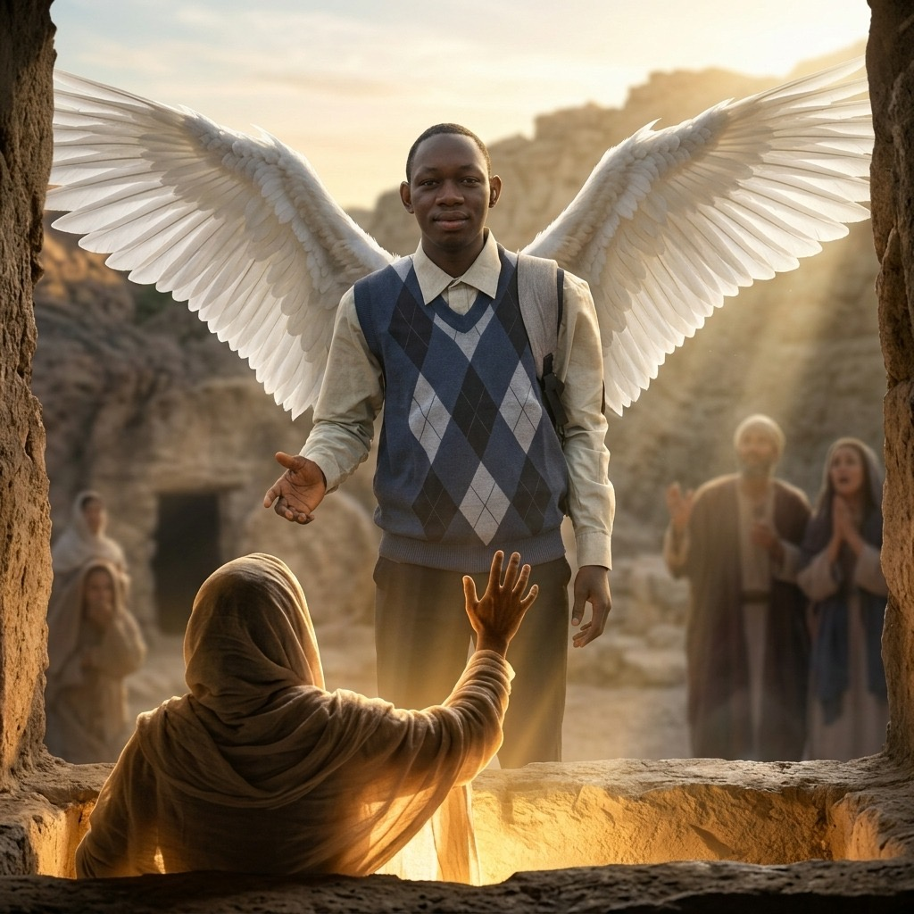
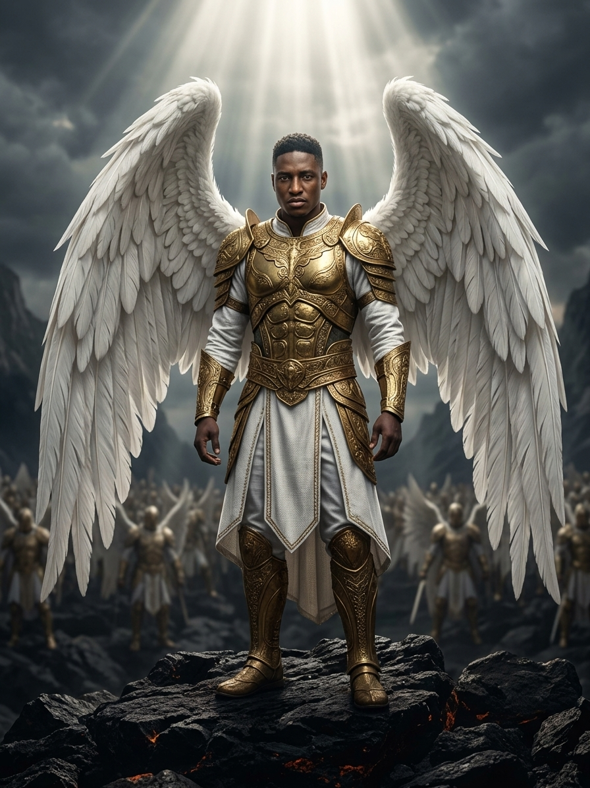

# The Supernaturals: an AI toolkit for event campaigns

<p align="center">
  
  
  
</p>

In 2026 I built two small AI apps for **IGC 2026 · The Supernaturals**, a three-day youth conference. This repo is the complete
record of what was built, what it produced and what I learned, **plus the same code, emptied of all event content, so you can
clone it and run your own campaign.**

- **Portrait app**: attendees upload a selfie, pick that week's scene and get a cinematic AI portrait of themselves to share.
  One scene went live per week for ten weeks, which kept the campaign in the feed.
- **Announcement poster app** (the twin): turn each confirmed guest's photo into a "CONFIRMED" poster and a 5-second video.
- **Event pages**: an about page, a sponsors page and a door-staff attendance system, all driven by JSON.

## The campaign in numbers

| | |
|---|---:|
| People on the registration sheet | **774** (434 pre-registered, 340 walk-ins) |
| Checked in on at least one day | **558** |
| First-timers among them | **325** (58%) |
| Portrait generations recorded | **136+** from **97** visitors |
| Scenes shipped | **10** (one live per week) |
| Announcement poster styles | **14** |
| Commits, 23 Jul to 12 Oct 2026 | **33** |

The generation count is a floor (the app stored no images, and its limit table keeps only each visitor's latest day).
Read the reports for the detail and the caveats:

- [Attendance report](docs/reports/ATTENDANCE_REPORT.md): by day, age, gender, church, area, source, check-in times
- [Generation report](docs/reports/GENERATION_REPORT.md): scenes, weekly schedule, day-by-day records
- [Build stats](docs/reports/BUILD_STATS.md): timeline, code size, what was built
- [Prompt lessons](docs/PROMPT_LESSONS.md): every way the model misbehaved, and the directive that fixed it

Reports contain aggregates only. No names, phone numbers or IP addresses are published.

## Gallery

Real outputs from the portrait app. Everything here was generated from an ordinary phone selfie.

<table>
<tr>
<td></td>
<td></td>
<td></td>
<td></td>
</tr>
<tr>
<td></td>
<td></td>
<td></td>
<td></td>
</tr>
<tr>
<td></td>
<td></td>
<td></td>
<td></td>
</tr>
</table>

## What's in the repo

```
portrait-app/        the portrait generator (FastAPI backend + React frontend)
minister-poster/     the announcement poster + video generator (the twin app)
docs/                guides, lessons and the campaign reports
images/              gallery of generated portraits
.github/workflows/   optional keep-warm ping for a free Render backend
```

The untouched 2026 build, with all event content, is preserved at git tag
[`event-2026-final`](../../tree/event-2026-final) (`git checkout event-2026-final`).

## Use it as a template

Everything event-specific has been removed or replaced with obvious placeholders ("Your Event 2027", "Example Scene One").
The two apps run as they are, so you can see the whole flow before you change anything.

1. Clone the repo and get a Google AI Studio key with billing enabled (there is no free image tier).
2. Start with `portrait-app/frontend/src/config/event.js` and `minister-poster/frontend/src/config/event.js` for your names, dates and links.
3. Replace the logo files in each app's `frontend/public/`.
4. Write your scenes: [`scene_prompts.py`](portrait-app/backend/scene_prompts.py) and [`scenes.js`](portrait-app/frontend/src/data/scenes.js).
5. Fill in the event pages in `portrait-app/frontend/src/data/event/`.
6. Deploy: [docs/DEPLOY.md](docs/DEPLOY.md).

The step-by-step version, with a checklist of every file to touch, is in **[docs/ADAPTING.md](docs/ADAPTING.md)**.

| Doc | What it covers |
|---|---|
| [docs/ADAPTING.md](docs/ADAPTING.md) | Turning the template into your event, file by file |
| [docs/PORTRAIT_APP.md](docs/PORTRAIT_APP.md) | How the portrait app works: API, env vars, rate limits |
| [minister-poster/README.md](minister-poster/README.md) | How the poster app works |
| [docs/DEPLOY.md](docs/DEPLOY.md) | Render + Vercel + Supabase + Apps Script setup |
| [docs/PROMPT_LESSONS.md](docs/PROMPT_LESSONS.md) | Prompt engineering and budget lessons |

## Tech stack

| Layer | Technology |
|---|---|
| Frontend | React 18, Vite, Tailwind CSS |
| Backend | FastAPI (Python 3.11+) |
| AI | Google Gemini image generation (`google-genai`); Veo for the poster videos |
| Limits and counters | Supabase Postgres (free tier). No images or personal data stored |
| Attendance | Google Sheets via an Apps Script web app |
| Hosting used | Render (backend), Vercel (frontend) |

## Before you deploy a copy

- Set your own keys in `.env` files (never committed; `.env.example` shows what each one is).
- The owner "vault" route and the poster app's admin dashboard are **off by default**. They have no built-in password, so a
  clone cannot be unlocked by anyone else. Enable them only by setting `VAULT_KEY_HASH` / `ADMIN_PASSWORD`.
- If you collect attendance, the sheet holds personal data. Keep it private and publish only aggregates, as the reports here do.
- This repository's history contains the real 2026 event's content (sponsor contact details, schedule). It was already public on the
  event's own pages. If you fork it for a different organisation, consider starting from a squashed copy of `main`.
